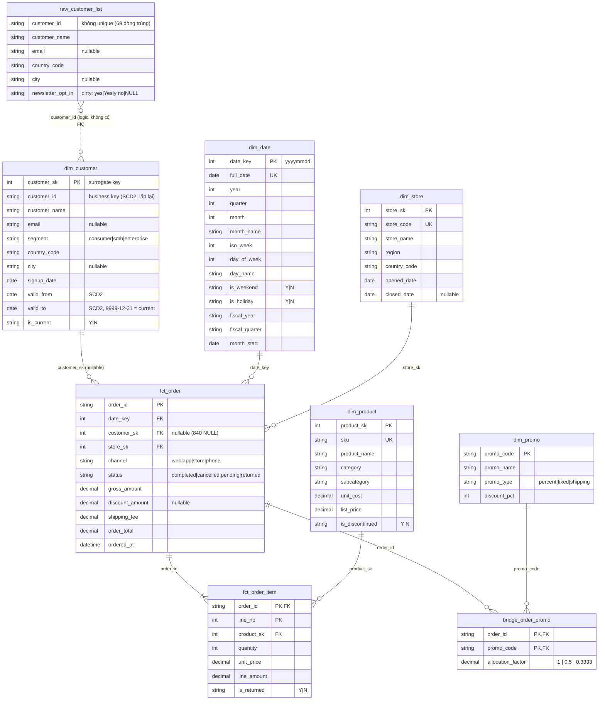

# Database Schema (Star Schema – Retail Orders)

> Mở file này trong VS Code rồi nhấn `Ctrl+Shift+V` (Markdown Preview) để xem sơ đồ.
> Nếu preview không hiện sơ đồ, cài extension **"Markdown Preview Mermaid Support"** (bierner.markdown-mermaid).

## Grain (mỗi dòng đại diện cho)

| Bảng | Grain | Số dòng |
|---|---|---|
| `fct_order` | 1 đơn hàng | 55,423 |
| `fct_order_item` | 1 dòng sản phẩm trong đơn (`order_id`, `line_no`) | 96,883 |
| `bridge_order_promo` | 1 promo áp dụng cho 1 đơn (`order_id`, `promo_code`) | 19,572 |
| `dim_customer` | 1 phiên bản của khách hàng (SCD Type 2) | 1,302 (1,200 khách) |
| `dim_date` | 1 ngày | 546 |
| `dim_product` | 1 sản phẩm | 180 |
| `dim_store` | 1 cửa hàng | 14 |
| `dim_promo` | 1 mã khuyến mãi | 8 |
| `raw_customer_list` | bảng staging/thô, không thuộc star schema | 1,269 |

## Ghi chú quan trọng

- **Toàn vẹn FK**: đã kiểm tra, không có khoá mồ côi ở bất kỳ quan hệ nào ở trên.
- **`dim_customer` là SCD2**: `customer_id` xuất hiện nhiều lần (102 khách có >1 phiên bản). Fact trỏ tới `customer_sk` (đúng phiên bản), không phải `customer_id`. Lọc bản hiện tại bằng `is_current = 'Y'`.
- **`fct_order.customer_sk` có 840 giá trị NULL** (đơn không gắn khách) → dùng LEFT JOIN, không dùng INNER JOIN nếu không muốn mất đơn.
- **`bridge_order_promo` là quan hệ N-N** giữa đơn và promo: một đơn có thể có nhiều promo. `allocation_factor` dùng để chia đều số tiền giảm giá, tránh đếm trùng khi JOIN (14,608 đơn có promo, 19,572 dòng bridge). Nhân `discount_amount * allocation_factor` khi tổng hợp theo promo.
- **`raw_customer_list`** có `customer_id` trùng, email/city thiếu và `newsletter_opt_in` không chuẩn (`yes`/`Yes`/`y`) → cần làm sạch trước khi nạp vào `dim_customer`.
- `dim_date.fiscal_quarter` lệch so với quý lịch (01/2025 → `FY2025-Q3`), tức năm tài chính bắt đầu vào tháng 7.
